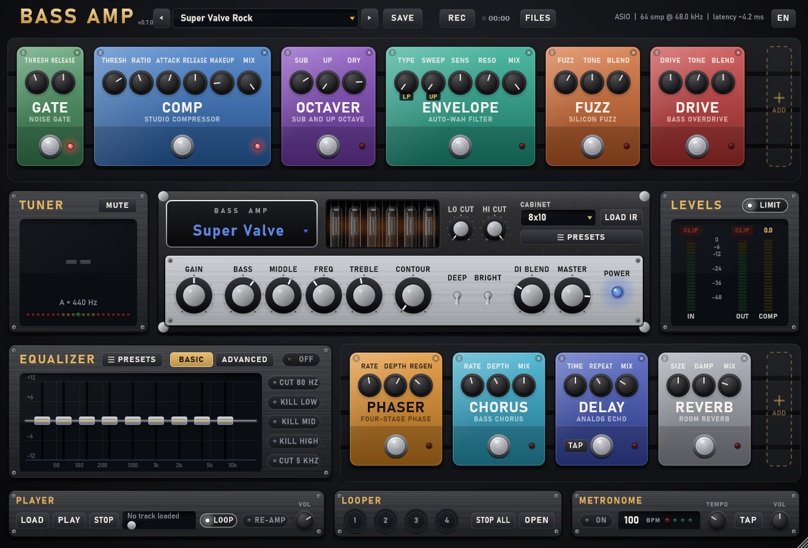

# Bass Amp

**English** | [Français](README.fr.md)

Free bass amp software (JUCE 8, C++17): a standalone app and plugins for Windows (VST3) and macOS (VST3, AU).



Default chain: **Gate → Compressor → Octaver → Envelope filter → Fuzz → Drive → Amp → Cabinet + DI → EQ → Phaser → Chorus → Delay → Reverb → Limiter**. Synth, Pitch, Filter, Wah, Flanger and Tremolo can be added to the pedalboard, and the pedal order changes with the mouse.

Also included: tuner (31 to 500 Hz, YIN detection), input and output meters with CLIP lights, compressor gain reduction, spectrum analyser, WAV recording, audio player, looper, metronome and MIDI control.

Found a bug or have an idea? [Open an issue](https://github.com/Weylland/bass-amp/issues).

## Quick start

1. Download the latest version from the [releases page](https://github.com/Weylland/bass-amp/releases/latest) and install it (see [Windows](#install-windows) or [macOS](#install-macos)).
2. Turn your speakers or headphones down before the first launch.
3. Plug your bass into your audio interface and open Bass Amp.
4. If you hear nothing, click **AUDIO** at the top right and choose your interface: driver (ASIO on Windows), input and output, sample rate and buffer size. If your bass is plugged into input 2, click **IN 1** under the input meter and pick **Input 2**.
5. Pick a sound in the preset list at the top, then hover any control for a second: a bubble explains what it does.

## Install (Windows)

Download from the [latest release](https://github.com/Weylland/bass-amp/releases/latest):

- **`BassAmp-x.y.z-Windows-x64-Setup.exe`** (recommended): installs the app, the VST3 plugin in `C:\Program Files\Common Files\VST3`, a Start menu shortcut and an uninstaller.
- Or the zips: `Standalone` holds `Bass Amp.exe`, which runs without installing; `VST3` holds `Bass Amp.vst3`, to copy into `C:\Program Files\Common Files\VST3`.

The app isn't signed with a paid certificate, so Windows SmartScreen may show **"Windows protected your PC"** the first time. Click **More info**, then **Run anyway**. The `SHA256SUMS.txt` file of each release lets you check the download.

## Install (macOS)

Download the macOS zips from the [latest release](https://github.com/Weylland/bass-amp/releases/latest). It's a universal binary (Apple Silicon and Intel), for macOS 10.15 or later.

- **Standalone**: drag `Bass Amp.app` into `Applications`.
- **Plugins**: copy `Bass Amp.vst3` into `~/Library/Audio/Plug-Ins/VST3` and `Bass Amp.component` into `~/Library/Audio/Plug-Ins/Components` (for Logic and GarageBand).

The app isn't notarized by Apple. On first launch, macOS refuses to open it: go to **System Settings → Privacy & Security** and click **Open Anyway**. For the plugins, this command removes the quarantine:

```bash
xattr -dr com.apple.quarantine ~/Library/Audio/Plug-Ins/VST3/"Bass Amp.vst3" ~/Library/Audio/Plug-Ins/Components/"Bass Amp.component"
```

On a Mac, the input is muted on first launch, because the default input is often the built-in microphone. Click **AUDIO** at the top right, choose your interface, then untick **Mute audio input**. macOS also asks for microphone access: allow it, or the bass stays silent.

## Amp

Preamp (tubes or transistors depending on the model), model voicing, tone section, then a power amp with sag. The whole amp runs 2x oversampled.

| Model | Inspired by | Character |
|---|---|---|
| Italian Hi-Fi | Markbass Little Mark | Neutral, modern solid state, great for slap |
| Super Valve | Ampeg SVT-CL | All-tube, warm low mids, rounded highs, sag |
| Nordic Drive | Darkglass B7K / Microtubes | Clean lows, driven top end, gritty mids |
| Tweed '59 | Fender Bassman 5F6-A | Passive tone stack modelled from the circuit (Yeh, Guitarix), round and vintage |
| Flip Top '60s | Ampeg B-15 | Low-power tubes, the Motown sound |
| West Coast 800 | Gallien-Krueger 800RB | Punchy solid state, 4 kHz highs, sharp attack |
| Stomp DI | Tech 21 SansAmp Bass Driver | Studio DI preamp, from clean to grit |
| NAM Capture | Your own capture (Neural Amp Modeler) | The sound of a real amp, captured by a neural network |

The brands and models named belong to their owners. They only describe the targeted sound: Bass Amp isn't affiliated with any of these manufacturers and uses none of their samples.

Amp controls:

- **Gain**, **Bass**, **Middle** with adjustable frequency (**Freq**), **Treble** and **Master**. Freq has no effect on Tweed '59, whose passive tone stack has fixed frequencies: it's greyed out.
- **Contour** scoops the mids around 380 Hz and opens the lows and highs, like the Markbass VPF.
- **Deep** adds lows and removes 500 Hz. **Bright** adds highs.
- **DI Blend** mixes the direct signal (before the amp) with the amp and cabinet, as in a studio.
- **Lo Cut** (20 to 250 Hz) and **Hi Cut** (1.5 to 20 kHz), at the top of the head: high-pass and low-pass filters on the amp output, to tighten the lows or soften the highs.

Cabinets: 8x10, 4x10, 1x15, 2x12, 2x10 Hi-Fi, Off (DI only), or **IR File**. **LOAD IR** loads a cabinet impulse response (WAV, AIFF, FLAC) and switches the cabinet to IR File. The file path is saved with user presets and the DAW session. With no IR loaded, IR File lets the signal through unchanged. If the file was moved or deleted, the head shows **File not found** next to its name.

The models are matched to the same perceived loudness at equal gain (less than 1 dB apart).

**NAM Capture** plays a `.nam` capture from [Neural Amp Modeler](https://www.neuralampmodeler.com/): thousands of free ones are on [TONE3000](https://www.tone3000.com/). **LOAD NAM** loads the file; the capture replaces the preamp and power amp, and the tone controls, Contour, Deep, Bright, the cabinet and DI Blend stay active after it. **Gain** sets the capture's input level (±12 dB). The loudness is normalised from the measurement stored in the file, as in the original NAM plugin. A capture is made for one sample rate (often 48 kHz): if the interface runs at another rate, the screen says so. The file path is saved with user presets and the DAW session; with no capture loaded, the signal goes through unchanged.

## Equalizer

Two modes, with an ON button for bypass:

- **Basic**: 9-band octave graphic EQ (33 Hz to 8 kHz), ±12 dB, with faders.
- **Advanced**: 6-point parametric EQ (low cut, low shelf, two mid bands, high shelf, high cut), ±18 dB. Drag the points on the curve; the mouse wheel sets the mids' Q and a double-click resets a point.

Switching modes crossfades, without clicks. The screen shows the EQ curve over the output spectrum. The EQ turns itself on when you touch a fader or a point. The low and high cut points only move sideways: they have no gain.

Quick cuts, right of the EQ, active in both modes and shown on the curve:

- **CUT 80 HZ** removes everything below 80 Hz, **CUT 5 KHZ** everything above 5 kHz (Linkwitz-Riley 24 dB/oct filters).
- **KILL LOW**, **KILL MID** and **KILL HIGH** remove a whole band (split at 250 Hz and 2.5 kHz), like the kills of a DJ mixer.

## Effects

- **Compressor** with **Mix** for parallel compression.
- **Octaver**: low octave (**Sub**), high octave (**Up**) and direct signal (**Dry**).
- **Synth**: bass synth driven by the played note, square or saw wave (**Wave**), resonant low-pass filter (**Cutoff**, **Reso**) opened by the attack (**Env**).
- **Pitch**: shift from -12 to +12 semitones (**Shift**), fine detune (**Detune**) and mix (**Mix**), for an octave up or a fifth.
- **Filter**: low-pass, band-pass or high-pass filter at 12 or 24 dB/oct (**Type**), frequency (**Cutoff**), resonance (**Reso**) and an LFO (**Rate**, **Depth**) for sweeps.
- **Envelope** (auto-wah): low-pass, band-pass or high-pass filter (**Type**) that opens or closes on the attack (**Sweep** Up/Down).
- **Wah**: bass wah, set with the **Pedal** knob or a MIDI expression pedal, with resonance and some direct signal (**Clean**).
- **Phaser**: 4 stages, rate, depth and feedback (**Regen**).
- Stereo **Flanger**: rate, depth, feedback and mix.
- Bass **Chorus**: the chorus only applies above 200 Hz, the lows stay centred and tight.
- **Tremolo**: rate, depth and shape (**Shape**, from sine to square).
- **Delay** and **Reverb**: low cut on the effect signal to keep the lows clear. **TAP** on the delay sets the time by tapping the tempo.
- **LIMIT** (LEVELS block, on by default): output limiter at -1 dBFS, transparent while the sound stays below that level.

A knob that has no effect in the current setting is greyed out: for example, the LFO **Rate** while **Depth** is at zero.

## Pedalboard

- **+ ADD** adds a pedal (and turns it on), the cross at the top right of a pedal removes it (and turns it off).
- Drag a pedal to move it on its pedalboard: the sound follows the order shown.
- The order is saved with user presets and the DAW session. A factory preset restores the default order.

## Practice

The bottom row:

- **Player**: **LOAD** opens a file (WAV, AIFF, FLAC, OGG, MP3) to play along, with play, pause, stop, position bar, loop and volume. **RE-AMP** feeds the file into the chain input instead of the bass, to run a DI track through the pedals and the amp again.
- **Looper**: 4 tracks of 30 s to build a song live. On a pad, the 1st click records, the 2nd plays the loop, then each click adds a layer (**DUB**) or goes back to playback. **OPEN** opens the full looper:
  - **SYNC**: with the metronome running, loops start and end on a bar (recording waits for the next bar). Otherwise the first loop sets the length the others follow.
  - **COUNT-IN**: with **SYNC** and the metronome running, the first loop waits for a full bar of clicks before recording, so you know when to come in.
  - **AUTO**: without the metronome, the first loop waits for you: recording starts on the first note you play (with 20 ms kept before it), so the loop has no silence at the start. Off: recording starts on the click.
  - **UNDO** / **REDO** on the last take or the last layer.
  - Per track: **STOP**, **CLEAR**, **REV** (reverse), **HALF** (half speed, one octave down) and **LEVEL**.
  - **TRIM**: while a track is the only loop, cuts its start or its end, for a click on the pad that came a bit early or late. Drag the two handles on the waveform while it plays; the whole take is kept and **RESET** brings it back.
  - **STOP ALL**, **CLEAR ALL**, and **EXPORT WAV**, which saves the track mix in `Documents/Bass Amp/Recordings`.
  - Right-click a pad or a looper button: **MIDI learn**, to drive it from a controller (pad, note or CC footswitch).
- **Metronome**: a soft click, tempo from 40 to 240 BPM with the knob or **TAP**, volume, and one light per beat. The click is never recorded by **REC**. In a DAW, the metronome and the looper follow the project tempo and bars.

## MIDI

- Right-click a knob, fader or switch, then **MIDI learn**, then move a control on your controller: the control blinks gold while it waits. The same menu forgets the mapping.
- A small gold dot marks every control driven by MIDI.
- A CC drives any setting. A pad (note) turns a switch on or off, or steps to the next choice.
- The pads and the looper buttons (tracks 1 to 4, undo, redo, stop all, clear all) fire on a note or a CC going above 64.
- By default, CC 11 (expression pedal) drives the wah.
- Program changes load the factory presets.
- Mappings are shared by all presets, in `Bass Amp/MidiMap.xml` (application data folder). The standalone app opens every MIDI input at launch.

## Presets

24 factory presets, built around reference sounds: Super Valve Rock, Super Valve Ultra, Soul Flip Top, Fifties Tweed, Rock Punch 4x10, Slap Hi-Fi, Jazz Warm, Stomp DI Studio, Stomp DI Grit, Crossover Metal, Crossover Djent, Punk Pick, Fuzz Lead, Funk Envelope, Synth Octave, Dub Deep, Fretless Phase, Ambient Chorus, Wah Funk, Analog Synth, Filter Sweep, Octave Up Lead, Jet Flanger, Surf Tremolo. They're matched in loudness, within 1 dB.

**SAVE** saves the current sound in `Documents/Bass Amp/Presets/<name>.bassamp`. The arrows step through the presets. In VST3, the factory presets also show up as programs in the DAW.

A gold **\*** before the preset name means the sound was changed since it was loaded. Loading another preset then asks for confirmation, so changes aren't lost by accident. **SAVE** also asks before replacing a preset of the same name.

The three-line button next to **SAVE** opens the preset menu:

- **Rename...** and **Delete...** the user preset loaded now (deleted presets go to the recycle bin).
- **Export...** saves the current sound as a zip, with its IR and NAM capture files, to share it.
- **Import...** adds a preset someone sent you (a `.bassamp` file or an exported zip); its IR and capture go into `Documents/Bass Amp/Presets/Files`.
- **Open presets folder**.

Each module also has its own presets, which only touch it:

- **PRESETS** under the head: 11 amp and cabinet settings, matched in loudness.
- **PRESETS** in the EQ: Flat, Vocals, Electric Guitar, Acoustic Guitar, Round Bass, Slap Smile, Rock Growl, Fingerstyle Warm, Anti-Mud, Old Radio.
- The three-line button at the top left of each pedal: 3 to 5 settings for that pedal.

In each of these menus, **Save...** adds the current settings of that module under a name of yours: your favourite fuzz, an EQ curve, an amp with its IR and NAM capture. They are listed under **User** and load on top of any sound, like the built-in ones; **Delete** removes one (it goes to the trash). They are kept in `Documents/Bass Amp/Presets/Modules/<module>`.

## Usage

- Hover an element (pedal, knob, button, screen) for a second: a bubble explains what it's for and how to use it.
- Double-click a knob: back to its default value. Hover or drag: the value shows.
- **Ctrl+Z** (**Cmd+Z** on Mac) undoes the last change (a knob, a preset load, a pedal added or moved), **Ctrl+Shift+Z** or **Ctrl+Y** redoes it. Controls driven by MIDI are left out.
- The window resizes (bottom right corner) from 70 % to 160 %, and reopens at its last size.
- Full screen (standalone app): the button at the top right or **F11**, **Esc** to go back to a window.
- Language: the button left of full screen (English, Français, Español, Deutsch, Italiano, Português). Help bubbles, messages and menus are translated; control names stay in English, as on real gear. By default, the system language.
- **IN CLIP**: the interface input clips, lower the interface gain. **OUT CLIP**: the output clips, lower the Master.
- Click the LEVELS block: clears the CLIP lights. Click **IN 1** under the input meter to use input 2 of the interface instead (or the right channel of a stereo DAW track).
- **MUTE** in the tuner silences the output while tuning. The mouse wheel on the tuner changes the reference pitch (A = 430 to 450 Hz), a double-click goes back to 440 Hz.
- **REC** records the output sound (effects included) as a 24-bit stereo WAV in `Documents/Bass Amp/Recordings`. **STOP** finishes the file, **FILES** opens the folder on the last recording. Writing to disk happens on a separate thread, so it adds no latency or crackles.
- **SPLIT**, set before **REC**, records two files side by side instead of the mix: `... - Bass.wav` (your rig, pedals and looper loops) and `... - Player.wav` (the song from the player), as 32-bit float WAVs, to balance or rework them later in a DAW. Put both at 0 dB and they add up to the mix, before the output limiter. With **RE-AMP**, the song goes through the rig, so it lands in the Bass file.
- The version number is shown next to the logo. At launch, Bass Amp asks GitHub whether a newer version exists: if so, a gold button at the top opens its download page. Nothing about you is sent.

## Latency

- Steinberg's ASIO SDK (GPLv3) is in `libs/asiosdk`: ASIO support is built in automatically.
- On first launch, the app picks the ASIO driver of the interface already in use (generic drivers such as ASIO4ALL or Realtek come last), with a 64-sample buffer. Without ASIO, it uses exclusive WASAPI.
- With ASIO, input and output are on the same interface: plug your headphones or speakers into the interface.
- **AUDIO** at the top right (or a click on the driver line next to it) opens the audio and MIDI settings: driver, interface, channels, sample rate, buffer size and MIDI inputs. The ASIO buffer size is set in the driver panel (**AUDIO → Control Panel**). The same settings are also in **Options → Audio/MIDI Settings** in the title bar.
- The line at the top right shows the driver, the buffer and the estimated round-trip latency.
- No effect adds latency: no look-ahead, minimum-phase IIR oversampling, and the tuner analyses the signal off the audio thread.

## Build

Windows: Visual Studio 2019 Build Tools (C++), CMake + Ninja (`pip install --user cmake ninja`).

```bat
git submodule update --init --recursive
build.bat
```

Output in `build\BassAmp_artefacts\Release\` (`Standalone\Bass Amp.exe` and `VST3\Bass Amp.vst3`). The installer is built with [Inno Setup](https://jrsoftware.org/isinfo.php) from `installer\BassAmp.iss`.

macOS: Xcode (command line tools) and CMake.

```bash
git submodule update --init --recursive
cmake -S . -B build -DCMAKE_BUILD_TYPE=Release -DCMAKE_OSX_ARCHITECTURES="arm64;x86_64"
cmake --build build --parallel
```

GitHub Actions CI builds and tests both platforms on every push, and checks the plugins with [pluginval](https://github.com/Tracktion/pluginval) (and `auval` for the AU). A `v*` tag publishes the zips and the Windows installer in a release.

DSP tests (tuner, effects, amp models, tone stack, cabinets and IRs, equalizer, limiter, pedal order, MIDI, looper with trim, metronome, player, NAM captures, presets with export and import, undo, input choice, translations, chain stability): `test.bat`.
`test.bat --snapshot ui.png [preset]` exports a picture of the interface, with the chosen factory preset.
`test.bat --artwork folder` exports the icon (1024 px) and the splash screen. The build icon is `Resources/icon.png`.

## License

AGPLv3 (see `LICENSE`), as required by JUCE's free licence. The ASIO SDK in `libs/asiosdk` is used under its GPLv3 licence. [NeuralAmpModelerCore](https://github.com/sdatkinson/NeuralAmpModelerCore) (MIT) and [Eigen](https://eigen.tuxfamily.org/) (MPL 2.0) are in `libs/NeuralAmpModelerCore`.
